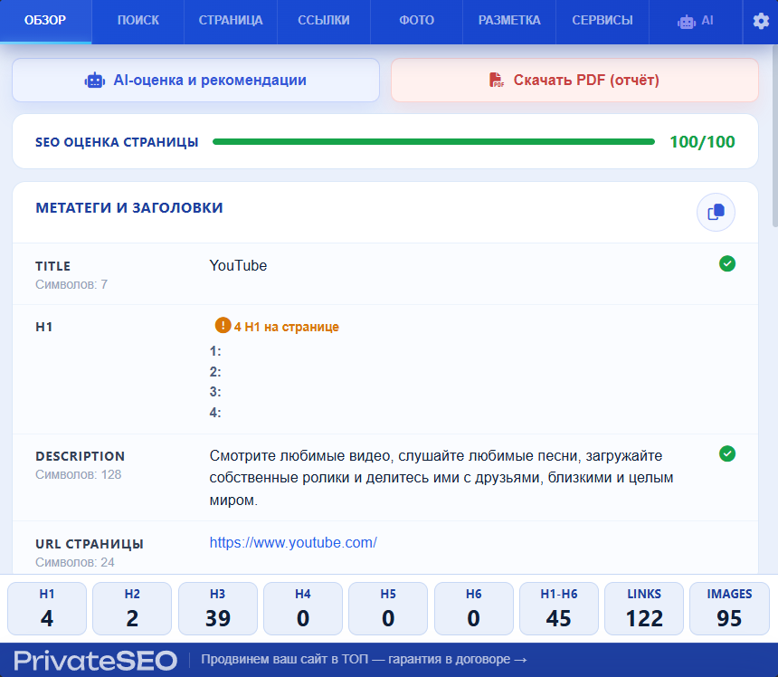

# PrivateSEO

Расширение для Chrome и других Chromium-браузеров. Проверяет SEO-параметры открытой
страницы, показывает замечания и собирает PDF-отчёт.



## Возможности

- Мета-теги, заголовки H1–H6, canonical, robots, hreflang и язык страницы.
- Ссылки, изображения без alt, Open Graph и JSON-LD.
- HTTP-статус, редиректы, robots.txt и sitemap.xml.
- Сигналы производительности текущей страницы.
- Локальная SEO-оценка и рекомендации по обнаруженным проблемам.
- Сохранение результатов в PDF.
- Подключаемый AI-анализ текста, поискового интента, переспама и мета-тегов.

AI работает через отдельный серверный прокси. Ключ провайдера в расширении не хранится.
В открытой сборке адрес прокси не задан; обычные SEO-проверки доступны без него.

## Установка

Нужны Node.js 22+ и Chromium-браузер.

```bash
npm ci
npm test
npm run build:chrome
```

Откройте `chrome://extensions`, включите режим разработчика, нажмите
«Загрузить распакованное расширение» и выберите папку `dist/chrome`.
Для ZIP-архива выполните `npm run zip:chrome`. Архив появится в `release/`.
Сборка и упаковка работают через Node.js на Windows, Linux и macOS.

## Подключение AI

Укажите HTTPS-адрес своего прокси при сборке. В PowerShell:

```powershell
$env:PRIVATESEO_AI_PROXY_URL = "https://your-server.example/seo-ai"
npm run build:chrome
```

В Linux или macOS:

```bash
PRIVATESEO_AI_PROXY_URL=https://your-server.example/seo-ai npm run build:chrome
```

Прокси принимает JSON с полем `action` и данными страницы. Поддерживаются действия
`generateMetaTags`, `analyzeIntent` и `analyzeSpam`. Контракт запросов и ответов
описан кодом `background/ai-checks.js` и проверяется тестами с заглушками.
Реализация сервера прокси в этот репозиторий не входит.

## Структура

```text
background.js                подключение обработчиков сообщений
background/
  network-checks.js          HTTP, robots, sitemap, DNS и размеры изображений
  ai-checks.js               проверка AI-запросов и обработка ответов
  ai-proxy-client.js         транспорт к серверному прокси с таймаутом
  search-checks.js           сценарий получения поисковой выдачи
  search-client.js           загрузка и разбор выдачи
  settings-checks.js         настройки JavaScript для текущего сайта
content.js                   сбор данных из DOM страницы
popup/domain/seo-audit.js    правила SEO-аудита без зависимости от DOM
popup/tabs/                  представления вкладок расширения
popup/bootstrap.js           инициализация интерфейса
report.html, report.js       представление отчёта и PDF-экспорт
scripts/                     сборка, упаковка и проверки
tests/                       тесты доменных правил и обработчиков
```

Обработчики фонового процесса имеют отдельные обязанности. AI-клиент и браузерные
API передаются через конструкторы, поэтому их можно заменить в тестах.

## Данные и ограничения

Для анализа расширение читает DOM активной вкладки. Текст отправляется в AI только
после запуска соответствующего действия. Для локальных и внутренних адресов
интерфейс дополнительно запрашивает подтверждение.

Некоторые сетевые проверки запускаются при открытии панели. Их список и назначение
описаны в [политике обработки данных](PRIVACY.md).

Оценка отражает технические признаки страницы и не гарантирует позиции в поиске.
Данные производительности зависят от момента открытия панели. Получение поисковой
выдачи может не работать при капче или изменении её разметки.

Проверки в CI выполняются без настоящих AI-запросов. Установку и поведение расширения
в браузере следует проверять отдельно на страницах, для которых оно будет использоваться.
